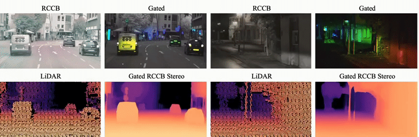

<div align="center">
  <h1 style="border-bottom: none; margin-bottom: 0px">Gated RCCB Stereo</h1>
  <h2 style="border-top: none; margin-top: 3px;">Cross-spectral Gated-RGB Stereo Depth Estimation</h2>
  <h3 style="border-top: none; margin-top: 3px;">CVPR 2024</h3>


  [**Samuel Brucker**](https://scholar.google.de/citations?user=TUmqR0kAAAAJ&hl=de) ·
  [**Stefanie Walz**](https://scholar.google.com/citations?user=ZeHkzXwAAAAJ) ·
  [**Mario Bijelic**](https://scholar.google.com/citations?user=aJV5jRYAAAAJ) ·
  [**Felix Heide**](https://www.cs.princeton.edu/~fheide/)
  <br>

  <a href="https://arxiv.org/abs/2405.12759">
    
  </a>
  <a href="https://light.princeton.edu/publication/gatedrccbstereo/">
    
  </a>
  <a href="https://light.princeton.edu/datasets/automated_driving_dataset/#long-range-stereo-extension">
    
  </a>

</div>

We propose Gated RCCB Stereo, a novel stereo-depth estimation method that is capable of exploiting multi-modal multi-view depth cues from RCCB and gated stereo images. We combine complementary cross-spectral features within an iterative stereo matching network with our proposed cross-spectral matching layer, utilizing intermediate depth estimations for accurate feature-registration.



## Environment Setup

Create and activate the conda environment:
```bash
conda create --name gatedrccbstereo python=3.8.8
conda activate gatedrccbstereo
```

Install dependencies:
```bash
pip install torch==2.0.1 torchvision==0.15.2 torchaudio==2.0.2
pip install timm
pip install smt==1.3.0
pip install openmim mmengine
mim install mmcv-full
pip install mmsegmentation==0.30.0
pip install einops
pip install ittr-pytorch
pip install cupy-cuda117
pip install scikit-image
pip install hydra-core
pip install tensorboardX
```
## Data Preparation

### 1) Download the dataset
[Download](https://light.princeton.edu/datasets/automated_driving_dataset/#long-range-stereo-extension) Gated RCCB Stereo Dataset **(Long-Range Stereo Extension)** 

### 2) Prepare dataset PKL files
Generate the dataset `.pkl` files using the provided split lists:
```bash
python dataset/create_pkl_gatedstereo.py --split_file splits/train_gatedstereo.txt --data_path /path/to/dataset
```

Repeat for the test splits:
```bash
python dataset/create_pkl_gatedstereo.py --split_file splits/test_day_gatedstereo.txt --data_path /path/to/dataset
python dataset/create_pkl_gatedstereo.py --split_file splits/test_night_gatedstereo.txt --data_path /path/to/dataset
```

### 3) Training
start training with:
```bash
python trainer.py
```
For training with reduced GPU memory requirements, train without the high-resolution prediction stage by lowering the resolution of the RCCB images with:
```bash
python trainer.py dataset.pipeline.cfg_list.4.scales.rccb=[512,1024]
```

### 4) Evaluation
Download pre-trained weights [here](https://drive.google.com/file/d/1x2vMwa_uTBxjirB73VciZXSsrm_cn2my/view?usp=sharing). \
Place them into 'checkpoints' folder.

Then start evaluation of pre-trained weights with:
```bash
python evaluator.py 
```
Or evaluate your own model with:
```bash
python evaluator.py resume_path=path/to/checkpoint.pt
```

## Citations
If you find Gated RCCB Stereo useful in your research or projects, please cite our work:
```bash
@inproceedings{bruckergatedrccbstereo,
title={Cross-Spectral Depth Estimation from RGB and NIR-Gated Stereo Images}, 
author={Samuel Brucker and Stefanie Walz and Mario Bijelic and Felix Heide},
journal={Proceedings of the IEEE Conference on Computer Vision and Pattern Recognition (CVPR)},
year={2024}
}
```


## RGB-left / NIR-right pretrained fine-tuning

Run from this repository with the existing `pytorch` environment:

```powershell
& D:\anaconda\envs\pytorch\python.exe -u train_rgb_nir_lidar_finetune.py --epochs 5 --limit 100 --log-interval 1
```

The default checkpoint is `gatedrccbstereo.pt`. Both image encoders (including
their feature necks), stereo attention/update modules, disparity decoder and
learned upsampling weights are loaded strictly and fine-tuned. No encoder is
reset or frozen by default. The original checkpoint uses RGB with 3 channels
and gated input with 5 channels, so the right NIR image is repeated into 5
channels. A checkpoint with a single-channel NIR encoder is also supported.
Same-side modality fusion remains disabled.

Default data directories are `I:\KEDADATA\data\fog\RGBS0`, `NIRS0` and
`depth_output_dense`; LiDAR PNG values are converted from millimetres to metres
with `--depth-scale 0.001`. The seeded split uses 90% for training and 10% for
validation (`--limit 100`: 90 training, 10 validation). Remove `--limit` to use
all matched triplets. Batch size is one; learning rate defaults to `1e-5`.

Outputs go to `rgb_nir_lidar_finetune_run`: per-epoch `loss.txt`, `history.json`,
`calibration.json`, and `latest.pt`. The loss retains LiDAR-derived depth and
disparity BerHu supervision. The existing `train_rgb_nir_lidar.py` remains the
scratch-training entry point.

Fine-tuning progress also prints `depth_mae_m` (metres) and `disp_mae_px`
(pixels), computed from the final output at valid LiDAR supervision pixels.
These are plain absolute errors, without BerHu or intermediate-iteration
weights, and do not change the training objective. Per-epoch train/validation
MAE columns are saved to `loss.txt`, `history.json` and checkpoint history.
Epoch MAE is the total absolute error divided by the total valid pixel count;
`NA` means no valid pixels. Training metrics use predictions from each training
step, while validation metrics evaluate the fixed model after that epoch.
Disparity targets are derived from LiDAR depth and calibration, not independent
disparity annotations. Metrics reuse the model's supervision targets, including
its existing depth clamp to 1--220 metres. Existing runs need a restart to enable these metrics;
old loss logs cannot be used to reconstruct MAE.

Test the fine-tuned checkpoint with rectified left RGB and right NIR images:

```powershell
& D:\anaconda\envs\pytorch\python.exe run_gatedrccbstereo_stereo.py --checkpoint .\rgb_nir_lidar_finetune_run\latest.pt --left path/to/left_rectified.png --right path/to/right_rectified.png --output .\rgb_nir_lidar_finetune_test
```

# qmy

python run_gatedrccbstereo_stereo.py --checkpoint ".\rgb_nir_lidar_scratch_run\latest.pt" --left "..\depth-视差图代码\data\10\cs_stereo_result\left_rectified.png" --right "..\depth-视差图代码\data\10\cs_stereo_result\right_rectified.png" --output "..\depth-视差图代码\data\10\gatedrccbstereo_latest1_50_result"
